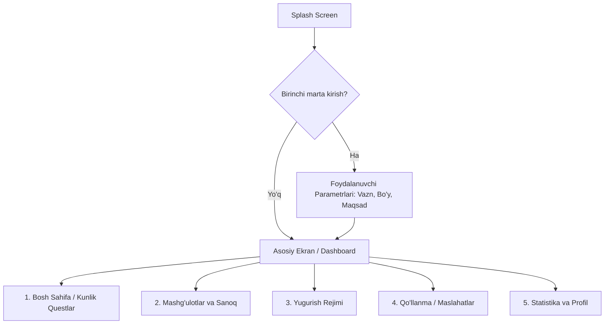
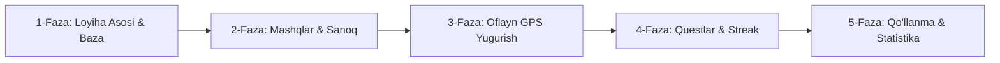

# "Badantarbiya va Salomatlik" Mobil Ilovasi — Mukammal Loyiha Rejasi

---

## 1. Loyiha Umumiy Ko'rinishi va Maqsadi

* **Loyiha nomi (ishchi):** *FitKundalik / Badantarbiya App*
* **Platforma:** Android (Native)
* **Asosiy maqsad:** Foydalanuvchilarni har kuni ertalabki va muntazam badantarbiya mashg'ulotlariga odatlantirish, kunlik topshiriqlar (questlar) orqali motivatsiyani oshirish, mashqlar sonini qulay hisoblash va to'liq **oflayn** rejimda yugurish masofasi, tezligi hamda sarflangan energiyasini nazorat qilish.
* **Asosiy tamoyil:** 100% oflayn ishlash, internet va tashqi pullik API kalitlarisiz mustaqil ishlash, batareyani tejash, sodda va chiroyli interfeys.

---

## 2. Texnologik Arxitektura

* **Dasturlash tili:** Kotlin
* **UI freymvorki:** Jetpack Compose (zamonaviy deklarativ UI, Material 3 dizayn tizimi)
* **Arxitektura uslubi:** Clean Architecture + MVVM (Model-View-ViewModel)
  * `Presentation Layer`: Composable UI funksiyalari, ViewModel, UI State (StateFlow)
  * `Domain Layer`: UseCase'lar (masalan: `CalculateRunStatsUseCase`, `GenerateDailyQuestsUseCase`)
  * `Data Layer`: Room Database, DataStore, Sensor/GPS Repository
* **Lokal xotira:**
  * **Room Database:** Mashqlar ro'yxati, yugurish tarixi, kunlik questlar arxivi.
  * **Jetpack DataStore:** Foydalanuvchi sozlamalari (bo'y, vazn, til, bildirishnoma vaqtlari, joriy Streak).
* **Geolokatsiya va Fon Jarayoni:**
  * `FusedLocationProviderClient` / `LocationManager` (Faqat GPS sun'iy yo'ldoshlari orqali oflayn ishlash).
  * `Foreground Service` + doimiy bildirishnoma (ekran o'chganda yoki ilova fonda bo'lganda ham yugurish to'xtab qolmasligi uchun).
* **Fon vazifalari:** `WorkManager` (Har kuni soat 00:00 da kunlik questlarni yangilash va ertalab eslatma bildirishnomasi jo'natish).

---

## 3. Ekranlar va Foydalanuvchi Yo'nalishi (Screen Flow)



### Ekranlar Tavsifi:
1. **Bosh Sahifa (Dashboard & Quests):**
   * Bugungi sana va salomlashish ("Xayrli tong, Ism!").
   * Streak hisoblagichi (masalan: 🔥 7 kun uzluksiz).
   * Bugungi 3 ta asosiy Quest kartochkasi va progress-bar.
   * Bugungi umumiy faollik ko'rsatkichi (bajarilgan mashqlar, umumiy sarflangan kkal).
2. **Mashg'ulotlar va Sanoq Sahifasi (Workouts & Counter):**
   * Tana qismlari bo'yicha bo'limlar: Bo'yin va yelkalar, Bel va umurtqa, Oyoqlar, Umumiy kardio.
   * Mashq kartochkalari (mashq nomi, rasm/animatsiya, tavsiya etilgan takror soni).
   * **Aktiv mashq ekrani:**
     * Katta raqamli hisoblagich (+ / - yoki ekranning istalgan joyiga bosish orqali).
     * To'plamlar (Sets) nazorati: 1-to'plam, 2-to'plam...
     * Dam olish taymeri (to'plamlar orasida 30-60 soniyalik teskari sanoq).
3. **Yugurish Rejimi Ekrani (Offline Run Tracker):**
   * Holat: *Tayyor -> Yugurishda -> Pauza -> Yakunlandi*.
   * Katta ko'rsatkichlar:
     * **Bosib o'tilgan masofa:** `0.00 km`
     * **Joriy vaqt:** `00:00:00`
     * **Tezlik:** `0.0 km/soat`
     * **Temp (Pace):** `0'00" min/km`
     * **Sarflangan kaloriya:** `0 kkal`
   * Boshqaruv tugmalari: Katta yashil "Boshlash", to'xtatib turish (Pauza), yakunlash (Finish).
   * Marshrut grafiki: Xarita shart emasligi sababli, yugurish davomidagi tezlik o'zgarishi dinamikasi chiziqli grafik ko'rinishida ko'rsatiladi.
4. **Qo'llanma va Maslahatlar (Guide):**
   * Ertalabki badantarbiyaning oltin qoidalari (suv ichish, to'g'ri nafas olish, chigalyozish tartibi).
   * Har bir mashqni xavfsiz va to'g'ri bajarish bo'yicha ko'rsatmalar.
5. **Statistika va Tarix (Stats):**
   * Hafta kunlari bo'yicha faollik ustunli diagrammasi.
   * Yugurish tarixi arxivi (sana, masofa, o'rtacha tezlik).
   * Erishilgan yutuqlar (Badges: "Birinchi 5 km", "10 kunlik streak", "1000 ta otjimanie").

---

## 4. Modullar va Mantiqiy Tizimlar

### 4.1. Kunlik Questlar Mantiqi (Gamification)
* **Generatsiya qoidasi:** Har kuni ertalab foydalanuvchiga 3 xil toifadagi quest beriladi:
  1. *Badantarbiya questi:* Masalan, "Ertalabki 5 daqiqalik bo'yin va bel mashqlarini bajaring".
  2. *Sanoqli mashq questi:* Masalan, "Bugun jami 30 ta o'tirib-turish (squat) bajaring".
  3. *Kardio/Yugurish questi:* Masalan, "Kamida 1.5 km masofani bosib o'ting".
* **Quest holatlari:** `NOT_STARTED`, `IN_PROGRESS`, `COMPLETED`.
* **Mukofot tizimi:** Har bir bajarilgan quest uchun XP (tajriba ballari) beriladi. Barcha 3 ta quest to'liq bajarilsa, foydalanuvchining **Streak** ko'rsatkichi 1 kunga ortadi. Agar bir kun qolib ketsa, Streak 0 ga tushadi (yoki "Muzlatish" imkoni beriladi).

### 4.2. Mashg'ulotlar Sanoqi va Taymer Mantiqi
* **Sanoq rejimlari:**
  * *Takroriy mashqlar (Rep-based):* Otjimanie, turnik, press. Har bir to'plam bajarilganda foydalanuvchi ekranga teginadi yoki tugmani bosadi.
  * *Vaqtga asoslangan mashqlar (Time-based):* Planka, statik cho'zilishlar. 30, 45, 60 soniyali avtomatik ovozli signalli taymer.
* **Ma'lumotlarni yozish:** Har bir bajarilgan to'plam darhol lokal xotiraga yoziladi va kunlik questlarga avtomatik hisoblab boriladi.

### 4.3. Oflayn Yugurish Rejimi (Masofa, Tezlik, Vaqt va Kaloriya)
* **GPS orqali ishlash tamoyili:**
  1. Faqat qurilmaning ichki GPS moduli ishlatiladi (internet talab qilinmaydi).
  2. `LocationCallback` orqali har 2-3 soniyada yoki har 5 metr harakatda yangi koordinata `(Lat1, Lon1)` olinadi.
  3. Koordinatalar orasidagi masofa Android'ning `Location.distanceBetween()` funksiyasi orqali aniq hisoblanadi.
  4. *Filtrlash (GPS Noise Filter):* Aniq bo'lmagan nuqtalarni chetlatish uchun `location.accuracy < 20` metr bo'lgan signallar qabul qilinadi.
* **Hisob-kitob formulalari:**
  * **Masofa:** \( \text{Umumiy Masofa} = \sum \Delta d_i \) (metrlardan kilometrga o'tkaziladi).
  * **Tezlik:** \( v = \frac{\text{Masofa (m)}}{\text{Vaqt (s)}} \times 3.6 \) (km/soat).
  * **Temp (Pace):** 1 km yugurish uchun ketgan vaqt: \( P = \frac{\text{Umumiy Vaqt (min)}}{\text{Umumiy Masofa (km)}} \).
  * **Kaloriya (MET formulasiga asoslangan):**
    \[
    \text{Kkal} = \text{MET} \times \text{Vazn (kg)} \times \text{Vaqt (soat)}
    \]
    *(Yugurish uchun o'rtacha MET koeffitsienti tezlikka qarab 7.0 dan 11.5 gacha olinadi).*
* **Orqa fonda uzluksiz ishlash:** Android 8.0+ tizimlari fon jarayonlarini to'xtatib qo'ymasligi uchun `Foreground Service` ishga tushiriladi va bildirishnoma panelida masofa va vaqt real vaqtda yangilanib turadi.

---

## 5. Ma'lumotlar Bazasi Sxemasi (Room Entities)

```
┌──────────────────────────────────────┐       ┌──────────────────────────────────────┐
│            exercises                 │       │            daily_quests              │
├──────────────────────────────────────┤       ├──────────────────────────────────────┤
│ id: Long (PK)                        │       │ id: Long (PK)                        │
│ title: String                        │       │ date: String (YYYY-MM-DD)            │
│ category: String (NECK/BACK/LEGS...) │       │ title: String                        │
│ description: String                  │       │ targetCount: Int                     │
│ isRepBased: Boolean                  │       │ currentCount: Int                    │
│ defaultRepsOrSeconds: Int            │       │ questType: String (EXERCISE/RUN)     │
│ animationAsset: String               │       │ xpReward: Int                        │
└──────────────────────────────────────┘       │ isCompleted: Boolean                 │
                                               └──────────────────────────────────────┘
┌──────────────────────────────────────┐       ┌──────────────────────────────────────┐
│           workout_logs               │       │              run_logs                │
├──────────────────────────────────────┤       ├──────────────────────────────────────┤
│ id: Long (PK)                        │       │ id: Long (PK)                        │
│ exerciseId: Long (FK)                │       │ startTime: Long (Timestamp)          │
│ timestamp: Long                      │       │ durationSeconds: Long                │
│ setsCompleted: Int                   │       │ distanceMeters: Float                │
│ totalReps: Int                       │       │ avgSpeedKmh: Float                   │
│ totalDurationSeconds: Int            │       │ caloriesBurned: Int                  │
└──────────────────────────────────────┘       │ avgPaceSecondsPerKm: Int             │
                                               └──────────────────────────────────────┘
```

---

## 6. Android Tizim Ruxsatnomalari (Permissions)

Ilova to'g'ri va xavfsiz ishlashi uchun AndroidManifest.xml faylida talab qilinadigan ruxsatlar:
1. `ACCESS_FINE_LOCATION` — Oflayn GPS orqali aniq masofa va koordinatalarni o'lchash uchun.
2. `ACCESS_COARSE_LOCATION` — Umumiy geolokatsiya uchun.
3. `FOREGROUND_SERVICE` & `FOREGROUND_SERVICE_LOCATION` (Android 14+) — Yugurish rejimida telefon cho'ntakda/ekran o'chiq bo'lganda ham hisob to'xtamasligi uchun.
4. `POST_NOTIFICATIONS` (Android 13+) — Ertalabki badantarbiya eslatmalari va yugurish paneli uchun.
5. `ACTIVITY_RECOGNITION` — (Ixtiyoriy) Agar telefonning o'rnatilgan qadam hisoblagich sensoridan foydalanilsa.

---

## 7. Bosqichma-bosqich Amalga Oshirish Xaritasi (5 Faza)



* **1-Faza (Baza va Dastlabki Tuzilma):**
  * Android Studio loyihasini Jetpack Compose bilan tayyorlash.
  * Room bazasi entity va DAO'larini yaratish.
  * Navigatsiya grafigi (Bottom Navigation Bar va asosiy 5 ta bo'lim).
* **2-Faza (Mashg'ulotlar Katalogi va Hisoblagich):**
  * Ertalabki badantarbiya mashqlari ro'yxati va ma'lumotlar bilan to'ldirish.
  * Interaktiv sanoq ekrani: takrorlarni sanash, to'plamlar (sets) va dam olish taymeri.
  * Mashq natijalarini `workout_logs` jadvaliga yozish.
* **3-Faza (Oflayn Yugurish Tracker):**
  * GPS ruxsatnomalarini so'rash mexanizmi.
  * `LocationTrackingService` — masofa, vaqt, tezlik va kaloriyalarni oflayn hisoblash xizmati.
  * Yugurish boshqaruvi UI (Boshlash, Pauza, Yakunlash va natija kartochkasi).
* **4-Faza (Kunlik Questlar va Gamifikatsiya):**
  * Har kungi avtomatik 3 ta quest yaratish mexanizmi.
  * Mashqlar yoki yugurish tugagach, quest progressini avtomatik oshirish.
  * Streak va darajalar (Level/XP) hisobi.
* **5-Faza (Qo'llanma, Statistika va Yakuniy Sayqallash):**
  * Badantarbiya mashqlarini to'g'ri bajarish bo'yicha maslahatlar va yo'riqnomalar.
  * Hafta davomidagi natijalar diagrammasi va umumiy xulosalar.
  * Sinovdan o'tkazish, batareya sarfini optimallashtirish.
